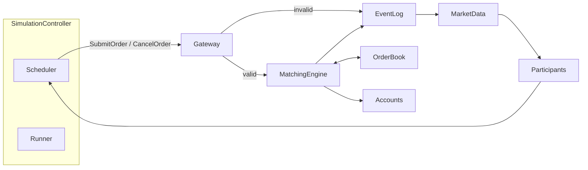

# Architecture

Exchange logic stays independent from simulation orchestration and visualization. Order state has one authoritative source of truth: the order book holds resting orders. The matching engine reads and updates that book; it does not keep a parallel copy of order state.

The matching engine is deterministic code, not a language model. Given the same valid state and the same event sequence, it produces the same outcome.

How an order moves through these components is in [exchange-operations.md](exchange-operations.md). Entity shapes and the order book structure are in [data-models-and-invariants.md](data-models-and-invariants.md). Build order is in [milestones.md](milestones.md).

## System context

Local simulation only. There is no live order routing. Participants submit through the scheduler; market data flows back to participants from the event log.

## Components

| Component | Responsibility |
| --- | --- |
| Market participants | Generate orders and react to market data |
| Exchange gateway and validation | Validate orders, assign IDs, reject invalid requests |
| Matching engine | Price-time priority and executions |
| Order book | Resting bids and asks |
| Account ledger | Cash, holdings, and fills |
| Market data and event log | Quotes, depth updates, trades, replay, and metrics |
| Simulation controller | Schedule events, control simulated time, and coordinate participants |

## Component ownership

Each box in the diagram maps to a future module under [Market](../Market/README.md) and to the milestone that first implements it. Modules are stubs until that milestone.

| Component | Module | First milestone |
| --- | --- | --- |
| Order book | `src/market/order_book.py` | 2 — Order book only |
| Shared entities (orders, trades, events) | `src/market/models.py` | 2 — with the book |
| Matching engine | `src/market/matching_engine.py` | 3 — Matching engine |
| Gateway and validation | `src/market/gateway.py` | 4 — Gateway and account ledger |
| Account ledger | `src/market/accounts.py` | 4 — Gateway and account ledger |
| Scheduler | `src/market/scheduler.py` | 5 — Simulation controller |
| Runner / simulation controller | `src/market/runner.py` | 5 — Simulation controller |
| Market data and event log | `src/market/market_data.py` | 6 — Market data feed and replay |
| Scripted participants | `src/market/participants.py` | 7 — Scripted participants |
| Metrics | `src/market/metrics.py` | 8 — Diagnostics and stress tests |

Authority rules that follow from this map:

- Resting order state lives in the order book. Matching updates that book; it does not invent a second store of residual quantity.
- Gateway validation happens before the book changes. An invalid order never mutates the book.
- Accounts update on the valid path after matching and the residual rule. See the [rulebook lifecycle](exchange-rulebook.md#lifecycle).
- The event log is the persistence surface for replay. Market data starts as complete snapshots.

## Technology boundaries that are already chosen

- Python, with typed interfaces and automated tests.
- Persistence is structured event logs and experiment configurations.
- The execution environment is a local simulation. There is no live order routing.
- The clock is a discrete-event simulated clock, not wall-clock polling.

How those pieces are built is the milestone plan, not this skeleton. Module files under [Market](../Market/README.md) name a future responsibility and contain no behavior.
