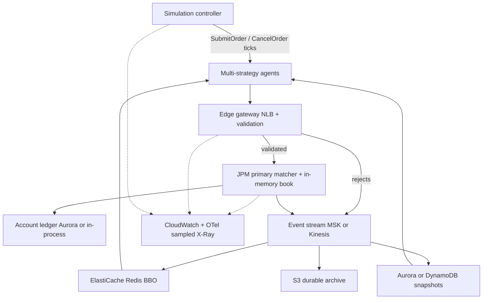

# AWS architecture (future)

Planning only. This document proposes how the Project 1 exchange could later run on AWS for reliability and scale while keeping **low latency** as a first-class goal. It does not deploy anything, change Market source, or replace the local discrete-event design in [architecture.md](architecture.md).

The local Python engine remains the correctness reference. See [future-milestones.md](future-milestones.md) for when (and whether) an AWS path is introduced after the eight local milestones.

## Goals and non-goals

| Goal | Meaning here |
| --- | --- |
| Reliability | Survive process failure, keep an authoritative book, durable event history |
| Scalability | Grow agents, instruments, and read paths without rewriting the matching model |
| Low latency | Prefer short paths on the hot order path; avoid serverless cold starts and chatty JSON REST for matching |

Non-goals for this plan:

- Live routing to a real venue
- Claiming multiple active matchers can all own one continuous price-time book for the same instrument
- Replacing the rulebook or the local milestone sequence

## Hard constraint: one book, one primary matcher

A continuous **price-time** limit order book for one instrument (`JPM`) needs a **single authoritative matching shard**. Horizontal scaling does **not** mean racing several matchers against the same book.

Why:

- Price-time priority is total order over arrivals at a price level. Two independent matchers without a shared primary will disagree on FIFO, self-trade prevention, and residual quantity.
- "Horizontally scalable matching" in production venues almost always means **partition by instrument** (or another disjoint key), not load-balanced replicas of one book.
- Sticky load balancing to many replicas of the *same* book still needs a primary/standby story; stickiness alone does not make concurrent writers safe.

**Recommended path for this project:**

1. **Now / first AWS cut:** one hot matcher process for `JPM` (active-passive optional for failover). Load balancer routes instrument traffic to that primary. Gateway replicas may scale out in front.
2. **When multiple instruments arrive:** shard by symbol — one active matcher (and book) per instrument partition. Scale matchers with the instrument set, not with request concurrency on a single symbol.
3. **Do not** put the hot matching loop on AWS Lambda.

Gateway validation, market-data fan-out, agent runtimes, and archival storage *can* scale horizontally. The matcher for a given book cannot.

## Proposed system flow

Order path (hot):

1. Simulation controller (or live clients later) injects `SubmitOrder` / `CancelOrder` toward agents or directly at the gateway.
2. **Edge / gateway** validates shape, tick, quantity bounds, and other rulebook checks that do not need the live book; assigns IDs where appropriate; rejects without touching the matcher when possible.
3. Valid requests go to the **single active matcher** for that instrument. Matcher owns the in-memory order book, matches price-time, applies residual rules and self-trade prevention per the [exchange rulebook](exchange-rulebook.md).
4. Matcher updates accounts (in-process synchronously for latency, or a tightly coupled ledger service) and emits events to the **event log stream**.
5. Market data consumers read BBO/depth from Redis and/or stream consumers; durable replay from the stream + S3 archive + periodic snapshots.

## Component mapping to AWS

### Edge / gateway

Prefer validation at the edge when the check is book-independent (off-tick price, non-positive price, unknown fields, min/max quantity when set). Book-dependent checks (buying power that needs reserved funds, self-trade against resting liquidity) stay with or next to the matcher.

| Option | Latency / fit | Notes |
| --- | --- | --- |
| **NLB + gRPC/protobuf or raw TCP** (default) | Lowest practical managed L4 path | Best for ultra-low latency; sticky to instrument primary |
| ALB + HTTP/JSON | Higher overhead | Fine for admin/control APIs, not the hot path |
| API Gateway | Extra hop, cold-adjacent patterns | Avoid for matching; OK for rare management |
| Custom host networking / EC2 ENI | Tightest control | More ops; consider only if NLB is proven insufficient |

**Default:** NLB in front of a small fleet of gateway tasks; protocol gRPC or framed protobuf/TCP; JSON REST only for non-hot APIs.

Validation placement:

- **At edge (preferred when feasible):** schema, tick, quantity bounds, basic authn/participant identity — keeps bad traffic off the matcher.
- **Matcher sidecar / co-process:** anything that needs live book or reserved balances; still avoid a second remote hop if latency budgets are tight (prefer in-process or localhost).

### Matching / order book service

| Option | Fit | Notes |
| --- | --- | --- |
| **ECS/Fargate, one active task per instrument** (default early) | Simple ops | Desired count 1 for `JPM`; optional warm standby |
| EKS with a Deployment/StatefulSet per shard | Good when many instruments | Same single-active rule per partition |
| EC2 | Max control / pinning | Use if you need dedicated hosts, kernel tunables, or pinned cores |
| Lambda | **Avoid on hot path** | Cold starts and time limits fight continuous matching |

Sticky sessions or, better, **instrument-based routing** (path/header/topic → shard) so all `JPM` orders hit one primary. Horizontal scale = more instruments / more shards, not more concurrent writers on `JPM`.

### Account ledger

| Option | Fit | Notes |
| --- | --- | --- |
| **In-process with matcher + async persist** (latency-first default) | Lowest hot-path latency | Persist fills/balances to Aurora asynchronously; reconcile offline |
| **Amazon Aurora PostgreSQL** (strict ledger default) | Double-entry, SQL reconciliation | Prefer when accounting correctness and audits dominate |
| DynamoDB | Extreme write scale later | Possible with careful single-item / transactional design; harder for classic double-entry |

Recommendation: start with **in-process ledger updates on the match path** for latency, durable write to **Aurora PostgreSQL** for the system of record and reconciliation. Move to a remote synchronous ledger service only when measurement shows it is needed and the latency budget still holds.

### Market data / event log

| Concern | Default | Alternative |
| --- | --- | --- |
| Live event stream | **Amazon MSK (Kafka)** | Kinesis Data Streams (simpler ops, less Kafka ecosystem) |
| Durable archive | **S3** | Glacier lifecycle for old runs |
| Snapshots / query | **Aurora** (or DynamoDB if key-value access dominates) | Athena over S3 for analytics |
| BBO fan-out | **ElastiCache Redis** | Direct stream consumers only (higher fan-out cost) |

Publish from the matcher after each accepted mutation: `OrderAccepted`, `OrderRejected`, `TradeExecuted`, book deltas, simulation ticks. Replay rebuilds state the same way the local engine does.

### Simulation controller / multi-strategy agents

Refine the controller so many agents with different strategies can participate without sharing process memory.

| Piece | Default | Alternative |
| --- | --- | --- |
| Agent runtime | **ECS tasks or EKS pods per agent (or per strategy class)** | One process with plugin strategies (simpler, less isolation) |
| Discrete-event ticks | **Central scheduler service** injecting `SubmitOrder` / `CancelOrder` | EventBridge Scheduler for coarse wall-clock jobs (poor fit for fine simulated time) |
| Controller ↔ agents | **MSK (or SQS) message bus** | Direct gRPC from controller (tighter coupling) |
| Agent → exchange | Through the **same gateway** as any participant | Bypass gateway only in local tests |

EventBridge is useful for *ops* schedules (start scenario, stop run), not as the microsecond/millisecond matching clock. Simulated time stays under a dedicated controller, as in the local design.

### Observability

| Tool | Role | Latency note |
| --- | --- | --- |
| CloudWatch metrics/logs | Baseline | Cheap; keep hot-path logging sampled |
| OpenTelemetry | Traces/metrics export | Prefer local aggregation |
| AWS X-Ray | Distributed traces | **Sample aggressively**; full tracing on the match path can add latency |

Separate **simulated timestamps** from **wall-clock processing latency**, same as the local architecture.

## Recommended default stack (summary)

1. **NLB + gRPC/protobuf gateway** with book-independent validation at the edge.
2. **ECS/Fargate (or EC2) single active matcher per instrument**; `JPM` is one shard; no Lambda on the hot path.
3. **In-process ledger on match + Aurora PostgreSQL** as durable accounts/snapshots.
4. **MSK (or Kinesis) + S3 archive + Redis BBO** for market data and replay.
5. **ECS/EKS agent tasks + central simulation controller + MSK/SQS bus**, with CloudWatch/OTel and heavily sampled X-Ray.

## Relation to local Project 1

| Local component ([architecture.md](architecture.md)) | AWS evolution |
| --- | --- |
| Gateway | Edge service behind NLB |
| Matching engine + order book | Single-primary service per instrument |
| Account ledger | In-process + Aurora (or Aurora-first if audits win) |
| Market data / event log | MSK/Kinesis + Redis + S3 + snapshots DB |
| Simulation controller / participants | Controller service + many agent tasks |

Do not cut over until the local engine can reproduce runs and pass invariants. Future phases: [future-milestones.md](future-milestones.md).
