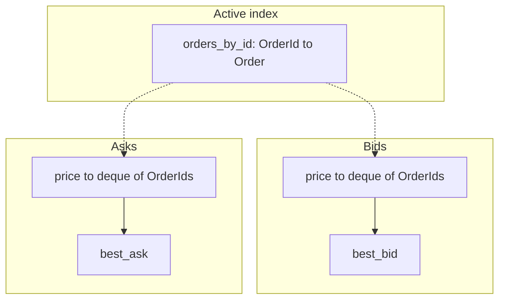

# Data models and invariants

Starting entities only. Add a field when a feature requires it. Do not add fields in advance.

Identifier format is not chosen. See the [rulebook](exchange-rulebook.md).

## Entities

### Order

- Order ID
- Participant ID
- Side
- Order type (limit or market)
- Price
- Original quantity
- Executed quantity
- Remaining quantity
- Arrival sequence

Original quantity, executed quantity, and remaining quantity stay distinct. Side and order type are enumerations, not free strings. Only limit orders rest in the book.

### Trade

- Trade ID
- Resting order ID
- Incoming order ID
- Execution price
- Quantity
- Simulated timestamp

The baseline execution price is the resting order's price.

### OrderBook

- Bid levels
- Ask levels
- Active-order index

Concrete structure and Milestone 2 APIs are below under [Order book structure](#order-book-structure).

### Account

- Cash balance
- Position
- Reserved funds
- Open orders

The account is a cash account. Buying power is 1:1 with equity, and there is no margin. How reserved funds are calculated is still open. Equity's exact composition is not specified.

### MarketEvent

- Event ID
- Event type
- Simulated timestamp
- Sequence number
- Payload

The explicit event types are `SubmitOrder`, `CancelOrder`, `OrderAccepted`, `OrderRejected`, and `TradeExecuted`.

### MarketSnapshot

- Best bid
- Best ask
- Depth
- Recent trades
- Market timestamp

### SimulationConfig

- Random seed
- Starting price
- Tick size
- Session length
- Participant settings

The symbol is `JPM`. Tick size defaults to 1 and is configurable. Participant settings are not given values. Scenario files under `Market/configs/` stay comments only. Project defaults are in `Config/`.

## Order book structure

Milestone 2 design. Correctness first. Standard library only. No execution in this milestone.

The book is the authoritative store of resting limit orders. Market-order residuals never enter it. Status enumeration labels and identifier format remain open; treat IDs as opaque typed values in prose and in later code.

### Internal layout

| Field | Shape | Role |
| --- | --- | --- |
| `orders_by_id` | `dict[OrderId, Order]` | Active-order index. O(1) find and cancel. Holds original, executed, and remaining quantity, side, price, arrival sequence, and participant ID. |
| `bids` | `dict[int, deque[OrderId]]` | Bid price → FIFO queue of order IDs. Higher price is better. |
| `asks` | `dict[int, deque[OrderId]]` | Ask price → FIFO queue of order IDs. Lower price is better. |
| `best_bid` | `int` or `None` | Cached best bid price. Updated on add, cancel, and level depletion. |
| `best_ask` | `int` or `None` | Cached best ask price. Updated on add, cancel, and level depletion. |

Empty price levels are deleted. The live book never shows a zero-quantity level.

### Why this shape

- Price–time priority maps directly: the best price key plus the head of that price's deque is the earliest eligible resting order at that price.
- Cancel by ID uses `orders_by_id`, then removes that ID from the price queue.
- Quantity decrease mutates `remaining_qty` on the `Order` in place and leaves the ID in the deque, so FIFO position is kept.
- Market orders never enter `bids` or `asks`.

### Milestone 2 public operations

No matching and no trade creation.

| Operation | Behavior |
| --- | --- |
| `add(order)` | Limit orders only. Insert the order ID at the tail of the price queue. Update the active index and BBO. |
| `cancel(order_id)` | Remove remaining quantity from the book. Reject if the order is unknown or already dead. |
| `reduce_quantity(order_id, new_remaining)` | Decrease only. Keep queue position. Reject an increase or any change that is not a pure quantity decrease (those are cancel-plus-new at the caller). |
| `get(order_id)` | Return the order from the active index, or indicate missing. |
| `best_bid()` / `best_ask()` | Return the cached best prices, or empty when that side has no levels. |
| `depth_at(side, price)` | Quantity at one price level. Helper for later market data. |
| Level / book snapshot helpers | Enough for later complete snapshots. Not a full market-data feed in Milestone 2. |

### Book-local invariants

- Remaining quantity is never negative.
- Cancel clears the order from both `orders_by_id` and its price queue.
- Empty levels are removed.
- Only limit residuals rest.

A non-crossed live book is a matching-engine post-condition after match and the residual rule (Milestone 3). The book alone does not enforce that every caller path avoids crosses; every book-changing path is assumed to go through matching once the engine exists. See the [rulebook](exchange-rulebook.md#residual-quantity-and-the-resting-book) and [exchange operations](exchange-operations.md).

## Invariants future tests must enforce

- No negative remaining quantity.
- Fill quantity never exceeds either order's remaining quantity.
- Limit-order price constraints are respected.
- Better-priced eligible orders execute first.
- Earlier eligible orders execute first at the same price.
- Cancelling an order removes its remaining quantity.
- Trade quantities reconcile with executed order quantities.
- Buyer and seller position changes offset.
- Buyer and seller cash transfers offset before fees.
- Replay reproduces the same final state.

Also required later, still without specified cases:

- Rejection paths
- Empty books
- Repeated cancellation requests
- Multiple orders at one price
- Simultaneous events with identical simulated timestamps

The test modules in `Market/tests/` name the invariant they will protect. They do not contain tests yet.
