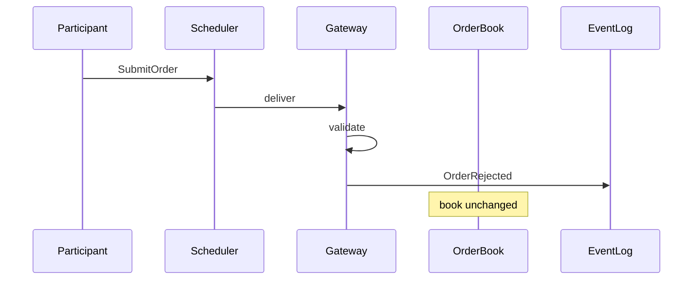
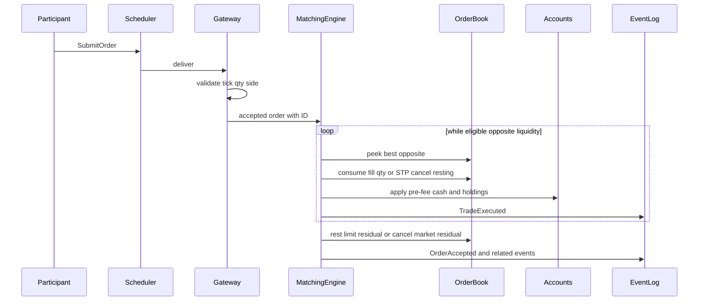

# Exchange operations

How an order moves through the Project 1 exchange. Behavior rules live in the [rulebook](exchange-rulebook.md). Component placement lives in [architecture.md](architecture.md). This document walks the pipeline so later milestones can be designed in chunks.

Do not invent answers to [open questions](exchange-rulebook.md#open-questions) here. Where a step depends on an undecided rule, the gap is named and left open.

## Lifecycle overview

From the rulebook:

1. Submit.
2. Validate.
3. Reject if invalid.
4. Otherwise match.
5. Apply the residual-order rule.
6. Update accounts.
7. Publish events.

No invalid order changes the book.

## Invalid path

The gateway rejects before the book changes. Decided rejection cases include off-tick prices and non-positive prices. Minimum and maximum quantity become constraints only after values are chosen in config. A repeated cancel of an unknown or already-dead order is also a rejection.

## Valid path

The relative order of `OrderAccepted` and `TradeExecuted` on the valid path is not decided. The diagram shows trades during the match loop and acceptance afterward as one readable layout, not as a fixed publish order. See the rulebook open questions.

## Per-component operations

### Gateway

**Does:** validate the incoming request; assign an order ID; reject invalid requests; forward a valid order to matching.

**Must not:** mutate the order book on a reject; invent matching decisions.

Decided validation before the book changes:

- Off-tick prices (not a multiple of configured tick size).
- Non-positive prices.

Later, once configured: minimum and maximum quantity. Identifier format is open.

### Matching engine

**Does:** walk eligible opposite-side resting orders until the incoming order cannot match further; produce trades; apply self-trade prevention; apply the residual rule; drive account updates and event publication on the valid path.

**Must not:** leave a live resting book that immediately crosses; rest unfilled market quantity; keep a private copy of resting order state apart from the book.

Decided matching rules:

- Full fills, partial fills, and multiple counterparties are in scope.
- Execution price is the resting order's price.
- A buy limit trades with resting sells at or below the buyer's limit. A sell limit trades with resting buys at or above the seller's limit.
- A market buy trades with any resting sell. A market sell trades with any resting bid. The order walks the opposite book in price-time priority until filled or liquidity is exhausted. Portions may execute at different resting prices. Market orders never rest.
- Better price first. Higher bid is better. Lower ask is better. At the same price, earlier arrival ranks first.
- Self-trade prevention cancels the resting order. The incoming taking order continues against other liquidity.

An unfilled market residual is cancelled and does not rest.

### Order book

**Does:** hold resting limit liquidity; support add, find, cancel, quantity decrease, and best bid/ask reporting.

**Must not:** rest market-order residuals; keep empty price levels; own matching policy (that belongs to the engine).

Decided book rules that callers must respect:

- Unfilled limit residual rests.
- Cancelling removes remaining quantity.
- Decreasing quantity keeps FIFO queue position.
- Any other modification is cancel plus a new order (caller responsibility; the book does not reinterpret price or side changes as in-place edits).

Structure and M2 APIs are in [data-models-and-invariants.md](data-models-and-invariants.md#order-book-structure).

### Accounts

**Does:** apply pre-fee cash and holdings transfers on each trade; track open orders for later submit checks.

**Must not:** apply fees or position limits in v1 until accounting is correct (those are deferred). Represent short sales.

Decided transfers: a trade decreases buyer cash and increases buyer holdings; it increases seller cash and decreases seller holdings. Buyer and seller position changes offset. Buyer and seller cash transfers offset before fees.

Still open: equity's exact composition, and how reserved funds are calculated. Open orders affect what a participant may submit next, but the numeric reserve formula is not specified.

### Event log and market data

**Does:** record explicit events; later publish snapshots (and incremental updates only if needed) so a consumer can rebuild the book.

Explicit event types: `SubmitOrder`, `CancelOrder`, `OrderAccepted`, `OrderRejected`, `TradeExecuted`.

Replay of the same inputs must reproduce the same final state. Same configuration, seed, and initial conditions reproduce the same event history and final state.

### Scheduler and runner

**Does:** hold a priority queue ordered by simulated timestamp, then a deterministic sequence number; advance the clock to the next event; coordinate participants with the exchange path.

**Must not:** poll wall-clock time as the exchange clock; conflate simulated timestamps with real processing timestamps.

## Cancel path

A cancel request is scheduled like a submit. The gateway or matching path looks up the order. If the order is unknown or already dead, the cancel is rejected. If it is live, remaining quantity is removed from the book and accounts/open-order state are updated as that milestone defines. No new trade is created by a cancel alone.

## Milestone chunk boundaries

Use these cuts when designing or implementing one piece at a time:

| Chunk | What can stand alone | What it still needs from later chunks |
| --- | --- | --- |
| Milestone 2 — Order book | Add, find, cancel, reduce quantity, best bid/ask | No execution; matching does not call it yet |
| Milestone 3 — Matching | Drive the book via match, STP, and residual rule; emit trade outcomes in tests | Gateway validation and live accounts can stay stubs or test harnesses |
| Milestone 4 — Gateway and accounts | Reject invalid orders before book changes; reconcile cash and holdings to trades | Scheduler and market data still optional |
| Milestone 5 — Simulation controller | Deterministic event queue and replayable runs | Full participant set and rich market data can wait |
| Milestone 6 — Market data | Snapshots (then increments if needed) rebuildable from the log | Scripted traders optional |
| Milestone 7–8 — Participants and diagnostics | Close the loop and explain runs | Depends on the path above being correct |

Milestone 2 can implement book operations without matching. Milestone 3 drives the book via match and residual. Milestone 4 adds validation and the ledger. Milestone 5 wires simulated time.
